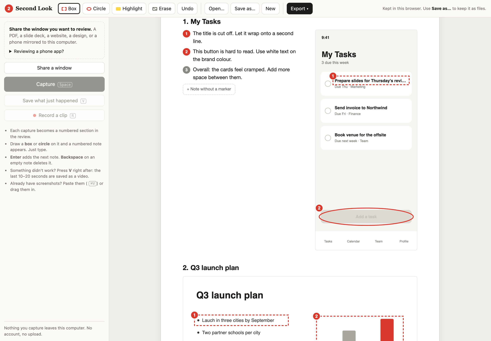

# Second Look

**AI builds it. You give it a second look.**

Capture any window, mark what's wrong, and the review writes itself: numbered notes beside every screenshot, ready to send to your team or hand to an AI agent.

**[Open Second Look](https://second-look-blond.vercel.app)** · **[See a sample review](https://second-look-blond.vercel.app/?sample)**



## Why

Giving good feedback on a screen is slow. You take a screenshot, move it to your computer, paste it into a document, draw on it, then write notes that try to describe where the problem is. Do that forty times and the review takes longer than the work it reviews.

Second Look turns that into one step. It was built to review a mobile app during development, and then used for everything else: posters, slide decks, PDFs.

## How it works

1. **Share a window.** A PDF, a slide deck, a website, a design tool, or a phone mirrored to your computer.
2. **Capture and mark.** Press `Space` to capture. Draw a box or circle on the screenshot and a numbered note appears beside it. Type what's wrong.
3. **Export.**
   - **Word report** for people. Each capture is a section with its notes; videos play inside the document.
   - **Markdown and marked-up images** for an AI agent such as Claude, Cursor or ChatGPT.

Also:

- **Save what just happened.** A recording runs quietly while you share. When something breaks, press `V` and the last 10–20 seconds become a video in the review.
- **Titles fill themselves in.** The heading of each capture is read from the image, on your device.
- **Your reviews, kept for you.** Every review you start is listed under **Reviews**, stored in your own browser. Anyone else who opens the site starts with an empty list of their own.
- **Pick up where you left off.** **Save as…** also writes a review to a plain folder (`review.json`, `shots/`, `clips/`) that you can back up, move to another computer, and open again.

## Privacy

Nothing you capture leaves your computer. There is no account, no upload and no analytics. The page makes no requests to other servers after it loads; even the text recognition runs in your browser.

## Requirements

- **Chrome or Edge** on Mac or Windows. Saving a review to a folder uses a browser feature that Safari and Firefox don't have; in those browsers you can still capture, mark up and export.
- To review a phone app, mirror the phone to your computer first:
  - **iPhone + Mac:** QuickTime Player → File → New Movie Recording → choose the iPhone as the camera.
  - **Android:** [scrcpy](https://github.com/Genymobile/scrcpy).
  - Or take screenshots on the phone and paste or drag them in.

## Keyboard

| Key | Action |
|---|---|
| `Space` | Capture |
| `V` | Save the last 10–20 seconds as a video |
| `R` | Start or stop recording a clip |
| `B` `C` `H` `E` | Box, circle, highlight, erase |
| `Enter` | Next note |
| `Backspace` on an empty note | Delete the note and its mark |
| `⌘Z` / `Ctrl+Z` | Undo the last mark |

## Run it yourself

It is a static site with no build step.

```bash
git clone https://github.com/melvynbrodie/second-look.git
cd second-look
python3 -m http.server 8000
```

Then open `http://localhost:8000` in Chrome or Edge.

## What it doesn't do

It is a tool for one reviewer writing one review. There is no shared commenting, no approvals, and no ticket tracker integration. If you need those, tools like Jam, BugHerd or Filestage are built for it.

## Licence

MIT. Third-party libraries are listed in [`vendor/README.md`](vendor/README.md).
